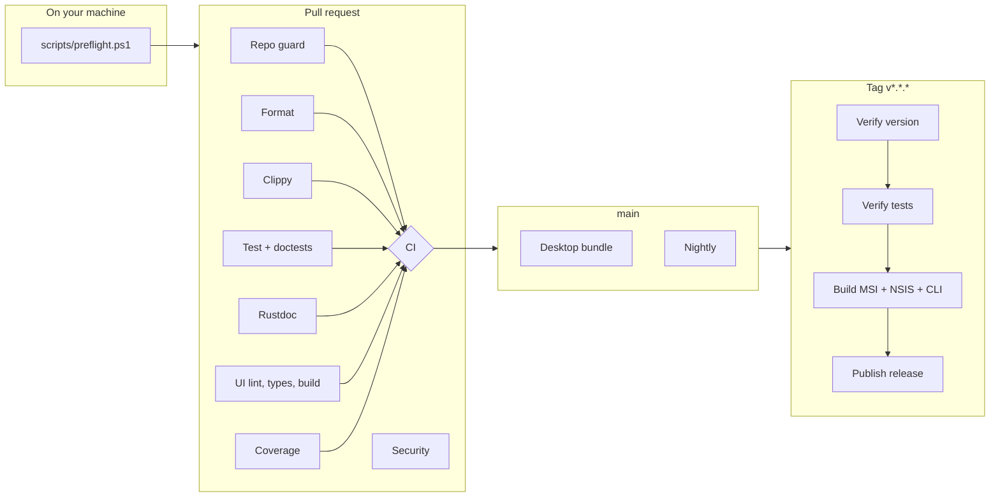

# CI/CD

How changes get from a branch to an installer, what is checked along the way,
and what to do when a check fails.

---

## Contents

1. [The shape of it](#the-shape-of-it)
2. [Workflows](#workflows)
3. [Every gate, and what to do when it fails](#every-gate-and-what-to-do-when-it-fails)
4. [Running the gates locally](#running-the-gates-locally)
5. [Branch protection](#branch-protection)
6. [Cutting a release](#cutting-a-release)
7. [Secrets and permissions](#secrets-and-permissions)
8. [Before the first run](#before-the-first-run)
9. [Cost and runtime](#cost-and-runtime)
10. [Troubleshooting](#troubleshooting)

---

## The shape of it



Four ideas run through the whole thing.

**One required check.** Branch protection requires exactly one status:
`CI`. It is a job that depends on every other job and fails if any of them
failed. Adding, renaming, or splitting a job never means touching repository
settings, which is where CI configurations normally rot.

**Windows is the real platform.** `ca-llm` binds the Windows Credential
Manager and the desktop crate builds against WebView2. Compiling on Linux
would compile a different program from the one users install, so the Rust
jobs run on `windows-latest`. Formatting, the UI, and repo hygiene are
genuinely platform-independent and run on Linux, where runners start faster.

**A red build must mean something.** Anything that fails for reasons the
author cannot control — a dependency published a breaking minor, a new
advisory landed overnight — lives in `nightly.yml` and reports rather than
blocks. A gate people learn to re-run instead of read is worse than no gate.

**Policy beats prose.** The codebase already contains decisions written as
comments: use symphonia rather than ffmpeg so nothing GPL reaches the
binary; use rustls rather than native-tls so there is no OpenSSL to build.
Comments do not fail a build. `deny.toml` does, and it says the same things.

---

## Workflows

| File | Runs on | Blocks a merge | What it is for |
|---|---|---|---|
| [`ci.yml`](../.github/workflows/ci.yml) | PR, push to `main`, merge queue | **Yes** — via the `CI` check | Correctness and quality of the change itself |
| [`security.yml`](../.github/workflows/security.yml) | PR, push to `main`, weekly | **Yes** — via the `Security` check | Secrets, licences, advisories, static analysis |
| [`release.yml`](../.github/workflows/release.yml) | Tag `v*.*.*`, manual | — | Builds and publishes installers |
| [`nightly.yml`](../.github/workflows/nightly.yml) | 03:00 UTC daily, manual | No | Slow and advisory checks |
| [`labeler.yml`](../.github/workflows/labeler.yml) | PR opened or updated | No | Path-based labels for review and release notes |

---

## Every gate, and what to do when it fails

### `ci.yml`

#### Repo guard — *ubuntu, ~1 min*

Four cheap checks that run before anything expensive:

- **Oversized files.** Any file added or modified by the PR that exceeds
  50 MB fails. GitHub warns at 50 MB and refuses the push at 100 MB, and a
  large file is permanent — removing it later means rewriting every commit
  after it. Model weights belong in [`scripts/fetch-models.ps1`](../scripts/fetch-models.ps1);
  build outputs belong in release assets.
- **Committed secrets and leftovers.** A tracked `.env`, or unresolved merge
  conflict markers.
- **Pre-existing large files.** Reported in the job summary, never fails.
  See [Before the first run](#before-the-first-run).
- **PR title.** Must follow Conventional Commits, matching the table in
  [CONTRIBUTING.md](../CONTRIBUTING.md). The title becomes the squash-merge
  commit message and therefore the release notes.

> **Fixing it:** rename the PR (the check re-runs on edit), or `git rm --cached`
> the file the guard objected to.

#### Format — *ubuntu, ~1 min*

`cargo fmt --all -- --check`.

> **Fixing it:** `cargo fmt --all`. If `cargo fmt` reports that rustfmt is
> not installed, `rustup component add rustfmt` — though `rust-toolchain.toml`
> now declares it, so a current rustup installs it for you.

#### Clippy — *windows, ~10–20 min*

`cargo clippy --workspace --all-targets --locked -- -D warnings`.
`--all-targets` includes tests and examples, which is where lint debt hides.

> **Fixing it:** `cargo clippy --workspace --all-targets --fix` handles the
> mechanical ones. For a lint that is wrong about your code, `#[allow(...)]`
> with a comment saying why is a legitimate answer — an unexplained `allow`
> is not.

#### Test — *windows, ~10–20 min*

Three things in order:

1. `cargo metadata --locked` — fails early and legibly if `Cargo.lock` is
   stale, rather than as an opaque resolver error inside a later build.
2. `cargo nextest run --workspace --all-targets --locked --profile ci`
3. `cargo test --doc --workspace --locked` — nextest does not run doctests,
   and doc examples rot quietly.

The `ci` nextest profile ([`.config/nextest.toml`](../.config/nextest.toml))
does not fail fast, so one run reports everything that is broken. It retries
once: nextest labels anything that only passes on retry as `FLAKY`, which
turns a random red build into a named problem instead of hiding it.

A JUnit report is uploaded as the `test-results` artifact.

#### Rustdoc — *windows, ~5–10 min*

`cargo doc --workspace --no-deps` with `RUSTDOCFLAGS=-D warnings`. Broken
intra-doc links are invisible until a reader clicks one.

#### UI — *ubuntu, ~2 min*

`npm ci`, then `npm run lint` (oxlint) and `npm run build` (`tsc -b && vite
build`, so the type check and the production bundle in one). The bundle is
uploaded as `ui-dist`.

> `npm ci` fails if `package.json` and `package-lock.json` disagree. If it
> does, run `npm install` locally and commit the updated lockfile.

#### Coverage — *windows, ~15–25 min*

`cargo llvm-cov` over the nextest run, excluding `src-tauri` — that crate is
the thin command layer between the window and the crates, and counting it
would measure untestable glue rather than the logic the tests aim at.

The percentage lands in the job summary; `lcov.info` is uploaded for any
external tool.

**The floor is currently `0`, on purpose.** A threshold invented before
anything was measured only teaches people to ignore the job. After the first
run, read the number from the summary and set `COVERAGE_MIN` in
[`ci.yml`](../.github/workflows/ci.yml) to just below it, then raise it as
coverage improves.

#### Desktop bundle — *windows, ~30–45 min, conditional*

Runs on pushes to `main`, on manual dispatch, and on a PR labelled
`full-build`. The bundler is the one part of the pipeline the other jobs
never exercise, and it fails in ways compilation does not catch — a missing
icon, a resource path that no longer resolves. Too slow for every PR;
[`labeler.yml`](../.github/labeler.yml) adds `full-build` automatically when
a PR touches `tauri.conf.json`, the icons, or `vendor/`.

---

### `security.yml`

| Job | Blocking | Notes |
|---|---|---|
| Secret scan (gitleaks) | Yes | Scans full history — a key that was committed and then removed is still leaked |
| `cargo-deny advisories` | Yes | RustSec vulnerabilities and yanked releases |
| `cargo-deny licences` | Yes | The allowlist in [`deny.toml`](../deny.toml) |
| `cargo-deny bans` | Yes | No OpenSSL, no ffmpeg — see below |
| `cargo-deny sources` | Yes | crates.io only |
| `npm audit` (shipped deps) | Yes | These reach users |
| `npm audit` (dev deps) | No | Affects whoever builds, not whoever runs |
| Dependency review | Yes, on PRs | New dependencies, before they merge |
| CodeQL (TypeScript) | Yes | The UI renders transcript text and PII |
| Workflow lint (actionlint) | Yes | The workflows are code and hold a token |
| OpenSSF Scorecard | No | Scheduled; grades repository settings |

**Why `deny.toml` bans what it bans.** `ca-audio` decodes with symphonia
(MPL-2.0) rather than ffmpeg, because ffmpeg with the usual feature set is
GPL and would force GPL on everything shipped alongside it. `ca-llm` uses
`reqwest` with `default-features = false` and rustls, so there is no C
OpenSSL to cross-compile or patch. Both are architectural decisions worth
more than the comment that currently records them, so `deny.toml` fails the
build if either is reversed.

> **A licence failure is not a formality.** Before adding to the `allow` list,
> read what the licence requires of a distributed binary. MPL-2.0 is on the
> list because its obligations are per-file and were accepted deliberately.
> GPL is absent for the same kind of reason.

> **Fixing a `bans` failure:** `cargo tree -i openssl-sys` names the
> dependency that pulled it in. Usually the fix is `default-features = false`
> on that dependency.

---

### `nightly.yml`

Nothing here blocks anything. All of it reports.

| Job | Question it answers |
|---|---|
| Desktop bundle | Does the product still package into an installer? |
| GNU toolchain parity | Local development builds with MinGW (`rust-toolchain.toml`), CI and releases build with MSVC. This watches the side CI does not see. |
| Latest dependencies | Ignores the lockfile and builds against the newest versions the manifests allow. When this breaks, a routine `cargo update` weeks from now would have broken instead — with less context and more urgency. |
| MSRV | Does the workspace still build on the `rust-version` it claims? |
| Code hygiene | `typos` and `cargo-machete` (unused dependencies) |

If the bundle job fails on a scheduled run, the workflow opens or updates an
issue labelled `nightly-failure`. A scheduled workflow that nobody has
starred otherwise fails silently forever.

---

## Running the gates locally

```powershell
pwsh scripts/preflight.ps1          # everything CI runs, in the same order
pwsh scripts/preflight.ps1 -Fix     # apply formatting and clippy's safe fixes
pwsh scripts/preflight.ps1 -Fast    # skip doctests, rustdoc, cargo-deny, UI
pwsh scripts/preflight.ps1 -SkipUi  # skip the frontend only
```

Git Bash and WSL: `scripts/preflight.sh [--fix] [--fast]`.

The script installs `rustfmt` and `clippy` if they are missing, and falls
back to `cargo test` when `cargo-nextest` is not installed. Two optional
tools make it match CI more closely:

```powershell
cargo install cargo-nextest --locked
cargo install cargo-deny --locked
```

Where the script and CI disagree, CI is right: it builds from a clean
checkout with the MSVC toolchain, and the script uses whatever you have.

---

## Branch protection

Run once, with the GitHub CLI authenticated as a repository admin:

```powershell
pwsh scripts/setup-branch-protection.ps1
```

It configures `main` to require:

- The `CI` and `Security` status checks
- One approving review, with stale approvals dismissed on a new push
- Code owner review for the paths in [`.github/CODEOWNERS`](../.github/CODEOWNERS)
- Conversation resolution before merge
- Linear history, and branches up to date with `main`
- No force pushes, no deletion — for administrators too

Run it with `-WhatIf` first to see what it would send.

> **Solo maintainer?** Requiring an approving review on your own repository
> means you cannot merge your own PRs. Pass `-AllowSelfMerge` to configure
> everything else and set required approvals to zero. The status checks still
> apply, which is the part that catches mistakes.

---

## Cutting a release

```powershell
# 1. Set the version in both places that record it.
#    Cargo.toml                          → [workspace.package] version
#    apps/desktop/src-tauri/tauri.conf.json → version
#    They must match the tag, and CI checks that they do.

# 2. Refresh the lockfile so the release builds --locked.
cargo update --workspace

# 3. Commit, merge to main through a PR as usual.

# 4. Tag the merged commit and push.
git tag v0.2.0
git push origin v0.2.0
```

The release workflow then:

1. **Verifies the version** — the tag, `Cargo.toml`, and `tauri.conf.json`
   must agree. Three places record the version and all three reach users:
   the download URL, the compiled binary, and what Windows shows in
   Add/Remove Programs. They drift silently, and the mismatch is usually
   discovered by a user.
2. **Runs the tests** on the exact tagged commit. Deliberately a real run
   rather than a lookup of whether CI passed: a tag can be moved, and a CI
   result can predate a force-push.
3. **Builds** the CLI and the MSI and NSIS installers, signs them if
   certificate secrets are configured, generates a CycloneDX SBOM, computes
   SHA-256 checksums, and attests build provenance.
4. **Publishes** a GitHub release with generated notes, categorised by
   [`.github/release.yml`](../.github/release.yml).

A pre-release is any tag with a hyphen: `v0.2.0-rc.1`.

**Rehearsing.** Run the workflow manually from the Actions tab with
*dry run* left ticked. Everything builds and every check runs; nothing is
published.

**Verifying a download**, as a user:

```powershell
(Get-FileHash .\CallAnalyzer_0.2.0_x64_en-US.msi -Algorithm SHA256).Hash.ToLower()
gh attestation verify .\CallAnalyzer_0.2.0_x64_en-US.msi --repo Yash-Kavaiya/call-analyzer
```

---

## Secrets and permissions

Nothing has to be configured for CI to work. Every secret below is optional
and its absence disables one feature rather than failing a run.

| Secret | Used by | Without it |
|---|---|---|
| `WINDOWS_CERTIFICATE` | `release.yml` | Installers are unsigned; Windows SmartScreen warns users |
| `WINDOWS_CERTIFICATE_PASSWORD` | `release.yml` | As above |
| `GITLEAKS_LICENSE` | `security.yml` | Only needed if the repository moves to an organisation |

`WINDOWS_CERTIFICATE` is a base64-encoded `.pfx`:

```powershell
[Convert]::ToBase64String([IO.File]::ReadAllBytes("cert.pfx")) | Set-Clipboard
```

Signing the installers is what this covers. To sign the executables *inside*
the bundle as well, set `bundle.windows.certificateThumbprint` in
`tauri.conf.json`.

**Token permissions.** Every workflow starts from `permissions: contents:
read` and elevates per job. Only three jobs get more: `publish` needs
`contents: write` to create the release, `build` needs `id-token: write` for
provenance attestation, and the labeler needs `pull-requests: write`.

The labeler is a separate workflow rather than a job in `ci.yml` for a
specific reason: it uses `pull_request_target`, which runs with a write
token. CI runs contributor code. A workflow that does both is the shape most
GitHub Actions compromises take, so the one holding the token checks out
nothing and runs nothing from the branch.

---

## Before the first run

Four things are known to need attention. They are listed here rather than
hidden in a comment, because the first CI run will surface them and it is
better to know why.

### 1. The repository cannot currently be pushed to GitHub

`models/ggml-small.en.bin` is 465 MB and is tracked. GitHub refuses any file
over 100 MB, so `git push` is rejected — and it is rejected for the *commit*,
not the file, so removing it in a new commit does not help. The blob has to
leave history.

Three options, in the order they should be considered:

**Fetch it at build time** — the intended fix. The file is a published
artifact from whisper.cpp, not source, and
[`scripts/fetch-models.ps1`](../scripts/fetch-models.ps1) downloads and
verifies it. `.gitignore` already excludes `models/*.bin` so it will not
come back.

```powershell
# Verify the download path works before removing anything.
pwsh scripts/fetch-models.ps1

# Rewrite history to drop the blob. Destructive — take a backup first.
# Requires git-filter-repo: pip install git-filter-repo
git filter-repo --path models/ggml-small.en.bin --invert-paths
```

**Git LFS** — keeps the file in the repository but stores it out of band.
Still requires rewriting history to migrate the existing blob, and LFS
bandwidth is metered.

**Start history fresh** — with two commits both named "first commit" and no
successful push, squashing to a single clean initial commit costs almost
nothing and is the simplest of the three.

Also tracked and probably unintended: `call-analyzer.db-shm` and
`call-analyzer.db-wal`, SQLite sidecar files that `.gitignore` already
covers.

```powershell
git rm --cached call-analyzer.db-shm call-analyzer.db-wal
```

`vendor/whisper/Release/` is 60 MB across many files and **should stay
tracked** — `tauri.conf.json` bundles it into the installer, so CI needs it
from the checkout. `.gitignore` has been amended to keep it.

### 2. Clippy has never run against this codebase

`cargo clippy` requires a full build, which needs several gigabytes of disk
that were not available on the machine this pipeline was written on. The
gate is set to `-D warnings` because that is where it should end up, but the
first run may well be red. That is a real backlog, not a broken gate:

```powershell
cargo clippy --workspace --all-targets --fix   # the mechanical ones
cargo clippy --workspace --all-targets -- -D warnings   # read what is left
```

The same applies to the Rustdoc gate.

### 3. Formatting has been normalised

`rustfmt` was not installed on the development machine and had never run.
`cargo fmt --all` has been applied across 45 files as part of this work, so
the Format gate passes. Reviewing it is best done with `git diff -w`.

### 4. The coverage floor is zero

Deliberate. See [Coverage](#coverage--windows-1525-min).

---

## Cost and runtime

A full PR run is roughly 10–15 minutes wall clock, with jobs in parallel.

Windows runners bill at **twice** the rate of Linux ones, which is why the
Rust jobs are the only ones there and why `desktop-build` is conditional.
On a **public** repository this is all free and none of it matters.

If the repository is private and minutes become a concern, in order of
saving-per-unit-of-regret:

1. Make `coverage` run only on pushes to `main` — add
   `if: github.event_name != 'pull_request'`.
2. Drop `docs` from the PR gate and move it to nightly.
3. Reduce the nightly schedule from daily to weekly.

`Swatinem/rust-cache` is configured with `save-if` set to `main` only. PR
branches read the cache but do not each write their own copy, which would
evict main's within a day and leave nothing hitting.

---

## Troubleshooting

**`error: the lock file needs to be updated but --locked was passed`**
`Cargo.toml` changed without `Cargo.lock`. Run `cargo update --workspace`
and commit the lockfile.

**`npm ci` fails with `EUSAGE`**
`package.json` and `package-lock.json` disagree. Run `npm install` in
`apps/desktop/ui` and commit the result.

**Clippy passes locally but fails in CI**
Local builds use the GNU toolchain (`rust-toolchain.toml` targets MinGW);
CI uses MSVC. Reproduce with
`cargo clippy --workspace --all-targets --target x86_64-pc-windows-msvc`.
The nightly `GNU toolchain parity` job exists to keep this gap visible.

**The formatting gate fails on a file you did not touch**
Almost always line endings. `.gitattributes` normalises everything to LF in
the repository; if the file predates that, `git add --renormalize .` fixes it.

**`desktop-build` did not run on my PR**
It is conditional. Add the `full-build` label, or push to `main`.

**A nightly job is failing and nobody has fixed it**
That is what the auto-filed `nightly-failure` issue is for. If it is noise
rather than signal, the job's `continue-on-error` should stay but the check
itself should be reconsidered — see the note about red builds at the top.

**The release workflow failed at "Verify version"**
The tag, `Cargo.toml`, and `tauri.conf.json` disagree. Fix the files, delete
and re-push the tag:

```powershell
git tag -d v0.2.0
git push origin :refs/tags/v0.2.0
# fix, commit, merge, then tag again
```
